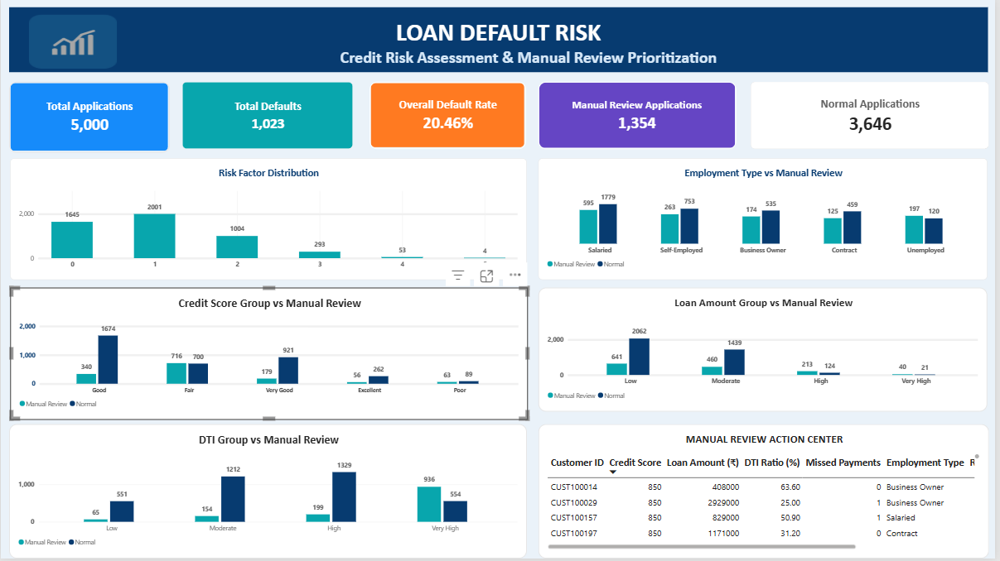
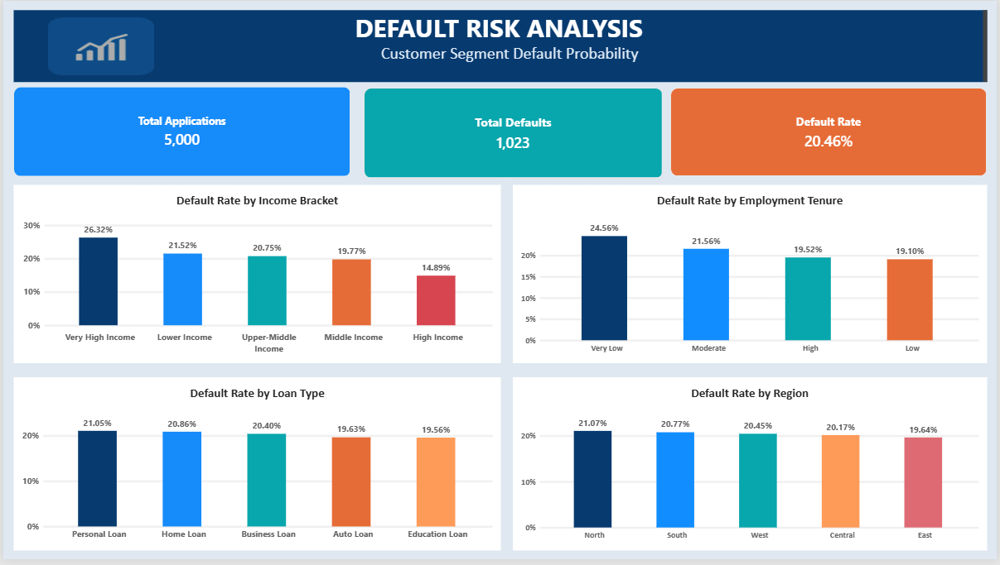

Loan Default Risk Analysis | SQL & Power BI
A data analytics portfolio project exploring loan default patterns and prioritizing applications for further manual credit-risk review using MySQL, SQL, Power BI, and DAX.

Project Overview
The Loan Default Risk Analysis project examines loan application data to understand historical default patterns, compare customer segments, and flag applications that may require additional manual review.

Using SQL for data validation and analysis and Power BI for interactive reporting, this project transforms loan data into meaningful business insights that can support structured credit-risk investigation.

Business Question: Which customer segments have higher loan default rates, and which applications should the credit team prioritize for further manual review?

Business Objectives
Analyze loan applications and calculate the overall default rate.

Compare default rates across income groups, loan types, employment history, and geography.

Examine risk indicators such as credit scores, debt-to-income (DTI) ratios, missed payments, and loan amounts.

Flag potentially higher-risk applications for further investigation.

Develop an interactive Power BI dashboard for risk analysis and business reporting.

Present findings in a clear, actionable format for stakeholders.

Tools and Technologies
Tool	Purpose
MySQL	Database queries and data validation
SQL	Filtering, aggregation, segmentation, and default-rate analysis
Microsoft Power BI	Interactive dashboards and visualizations
DAX	Measures, KPI calculations, and reporting logic
GitHub	Version control and project documentation

Project Structure
Loan-Default-Risk-Analysis/
├── README.md
├── dashboard/
│   └── Loan_Default_Risk_Analysis.pbix
├── screenshots/
│   ├── page1_Loan_Risk_Analysis.png
│   └── page2_default_Risk_analysis.png
└── sql/
    ├── data_validation.sql
    ├── default_rate_analysis.sql
    └── manual_review_logic.sql

    
Dashboard Preview
Page 1 — Manual Review Dashboard
This dashboard focuses on applications that may require additional investigation.

Key components:

Loan application and default-related KPI cards

Manual-review application counts

Risk-factor distribution

Manual-review analysis by employment type

Credit score, loan amount, and DTI risk analysis

Manual Review Action Center to examine flagged applications

Business purpose: Help prioritize applications for further manual review based on selected risk indicators.

Page 2 — Default Risk Analysis
This dashboard explores how historical default rates vary across customer segments.

Key visualizations:

Default Rate by Income Bracket

Default Rate by Loan Type

Default Rate by Employment History

Default Rate by Geography

Business purpose: Compare historical default patterns across customer segments and identify areas that may warrant closer investigation.

Dataset Overview
The project uses a loan-risk dataset containing customer and loan application attributes, including a target variable indicating whether a recorded default occurred.

Key fields used in the analysis include:

Customer ID

Credit Score and Credit Score Group

Income Group

Loan Amount

Loan Type

Debt-to-Income Ratio

Missed Payments

Employment Type and Employment History

Region and City Tier

Default Flag

Manual Review Flag

Target variable: Default_Flag

0 — No recorded default

1 — Recorded default

The dataset is used for analytical and educational purposes. Any publicly shared data should be permitted for redistribution and must not contain confidential or identifying personal information.

SQL Analysis
The SQL analysis is organized into three scripts.

1. Data Validation — data_validation.sql
Check the total number of applications.

Examine default and non-default records.

Calculate the overall default rate.

Validate important fields and summary statistics.

2. Default Rate Analysis — default_rate_analysis.sql
Analyze default rates by credit score group.

Compare default rates across income groups.

Examine default rates by loan type and employment type.

Investigate regional differences and other available customer segments.

3. Manual Review Logic — manual_review_logic.sql
Examine manual-review flags.

Identify applications matching selected risk indicators.

Compare application counts and default rates for flagged records.

Support prioritization of applications for further investigation.

Key Findings
The analysis reports the following figures for the dataset:

Metric	Result
Total Loan Applications	5,000
Recorded Defaults	1,023
Overall Default Rate	20.46%
Overall default rate calculation:

(Recorded Defaults / Total Loan Applications) × 100

(1,023 / 5,000) × 100 = 20.46%

These figures summarize historical outcomes in the analyzed dataset. They provide a starting point for further investigation and should not be interpreted as guaranteed future default rates.

Business Value
This project demonstrates how SQL and Power BI can be used to:

Convert raw data into meaningful business metrics.

Compare customer segments using default-rate analysis.

Examine potential risk indicators.

Build interactive dashboards for business reporting.

Support structured manual-review prioritization.

Communicate analytical findings clearly to business stakeholders.

Limitations
The analysis describes historical data and does not establish causation.

The manual-review rules are exploratory and have not been established as a validated lending model.

The dashboard does not guarantee future loan-default predictions.

Real-world lending decisions require appropriate model validation, fairness checks, regulatory compliance, and human oversight.

Results depend on the quality and completeness of the source dataset.

How to Explore the Project
Open the SQL scripts in the sql/ folder to review the analysis.

Open dashboard/Loan_Default_Risk_Analysis.pbix using Microsoft Power BI Desktop.

Explore both dashboard pages and their visualizations.

View the dashboard screenshots in the screenshots/ folder.

Author
Molay Mohanta
Computer Science and Engineering Graduate

Areas of Interest: Data Analytics, Business Analytics, SQL, Power BI, and Data-Driven Decision Making.

Dashboard Preview

Page 1: Loan Risk Analysis — Manual Review Dashboard

Page 2: Default Risk Analysis

